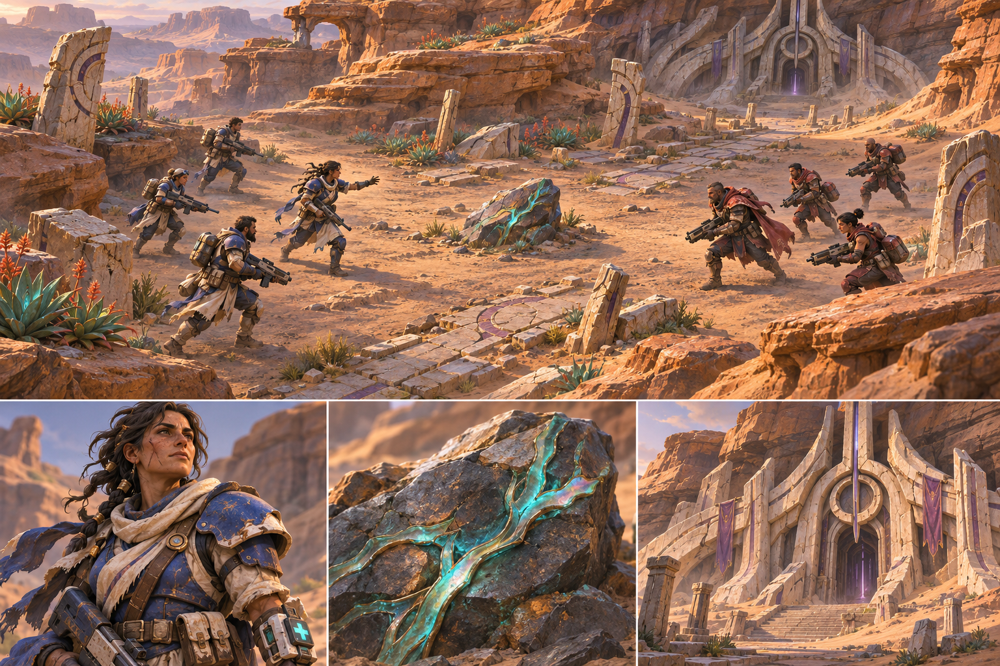

# Balance — visual direction

Approved direction, 8 November 2026. The first concept board is our reference
for mood, materials, and the relationship between people, machines, and ruins.
It is not a promise that the current procedural 3D scene matches its fidelity.

## The world in one sentence

People in worn, modern armor struggle over precious metal in ancient landscapes
whose history they only partly understand.

## Visual pillars

1. **Ancient worlds, modern machinery.** Processional roads and sacred entrances
   share a world with field medical equipment, armored vehicles, and refineries.
   Buildings should suggest who built them and what people do inside them.
2. **Biological characters.** Faces, hands, cloth, posture, and individual wear
   communicate personality. Armor protects a person; it does not erase them.
   The transforming harvester has a deliberately mechanical construction.
3. **Embedded Korali.** Turquoise, opalescent metal branches through dark stone.
   Small exposed seams catch light; the whole deposit is not a glowing lamp.
4. **Beauty alongside danger.** Warm sandstone, cool shadows, unusual plants,
   wind, and atmospheric depth. A battlefield was a place before the fight began.

## Faction language

| Faction | Silhouette and construction | Materials and color | Emotional impression |
| --- | --- | --- | --- |
| Blue | Protective overlapping armor; practical, slightly individual equipment | Cobalt, weathered ivory cloth, muted bronze, visible repairs | Capable people whose ideals can be tested |
| Red | Angular plates, disciplined repeated shapes, substantial weapons | Oxblood/crimson, charcoal, copper; controlled warm weapon accents | Effective, imposing, certain of their right to command |
| Green | Asymmetry, adapted gear, hidden tools and weapons | Forest/olive accents, worn leather, mixed metal; small personal trophies | Resourceful individuals, dangerous bargains |
| Clergy | Ceremonial symmetry, monumental ribs and sealed forms | Ivory stone, palatinate fabric, sparse violet light | Authority older than the current political struggle |

Color reinforces silhouette. Avoid making every surface bright faction color.
Blue and Red must remain distinguishable at the gameplay camera height.
The Clergy need not look visibly evil: imposing beauty makes their power credible.
Do not reveal its leader's species or full appearance in early imagery.

## First Contact: composition

- A clear central basin, framed by layered sandstone cliffs and sparse succulents.
- A broken processional road connects the foreground to a sealed northern entrance.
- The ore breaks through older worked stone. These ruins belong to the scene,
  rather than appearing only when the ending mentions them.
- Keep the fighting area comparatively quiet. Concentrate detail at its edges.
- Warm low sunlight and cool ambient fill; avoid blown-out sand or neon foliage.
- A high gameplay camera and strong unit silhouettes preserve readability.
- Interface: dark blue-charcoal, parchment/ivory text, restrained bronze rules,
  blue/red tactical accents. Narrative panels should read like mission briefings.

## Current implementation and next art work

The first environment pass uses original procedural rocks, stonework, road,
plants, shaders, and faction accents. These establish composition and palette.
They are replaceable production studies, not the final character art solution.

First Contact 0.4 develops the basin as a storm-damaged oasis outpost around an
older sacred site. A breached cistern, torn pipe, and remnant water connect the
scene to the settlement's need. Broken aqueduct supports extend the ancient
architecture. Teal desert trees and grasses occupy border pockets, leaving the
central combat area open. Sand has silt and runoff variation; stone uses softer
weathering instead of uniform stripes. Physical ledges break up the northern
cliffs, and the landscape rises outside the flat navigation area.

Water and foliage have restrained ambient shader animation. These are visual
details, not a weather simulation. New solid props have navigation footprints;
the navigation check verifies that every remaining walkable cell is connected.
The opening camera frames the sanctuary, and close zoom remains available.

Character Studio now provides the first coherent CC0-based trio: Blue Captain,
regular soldier, and Red Commander. It supports close-up rotation, lighting, and
authored animation review. Following the creator's positive review, the same
assembly now supplies the full mission roster, with lighter scouts, broader
heavies, faction materials, and simulation-driven animation. The mission camera
starts closer and permits tighter inspection while retaining an overview zoom.
See `CHARACTER_STUDY.md` for source provenance and current limitations. These are
intermediate low-poly studies; the reference remains the desired material and
character-detail target. Availability alone does not make a pack the final choice.

The creator subsequently requested the next character asset explicitly as the
**woman Blue Leader**, following the concept's lower-left portrait. Her name,
exact facial identity and voice remain open. This does not fix other characters'
genders, species or identities.

Woman Blue Leader candidate 01 was rejected: the hollow/lifeless face, toy-like
armor and awkward animation did not communicate the reference's beauty,
vitality, strength or confidence. Revision 02 begins with an anatomical MPFB
foundation and a separate static face/shoulders checkpoint. Costume and motion
must follow that foundation, not force the body to an old placeholder rig.
The creator subsequently authorized interim mission integration of revision 02 while deferring further appearance changes. See `BLUE_LEADER_REBUILD.md` for the recorded likeness feedback and composite-body limits.

## Concept generation record

The board was generated with the built-in image generation tool, not downloaded
from a stock pack and not declared CC0. The source PNG is preserved in
`assets/concepts/first-contact-v1.png`. It is reference art only, not a gameplay
background hiding the 3D scene. The generation prompt is retained in
`assets/concepts/first-contact-v1.prompt.txt`.
